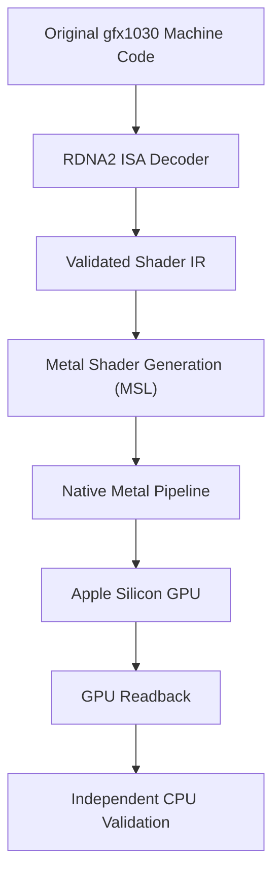
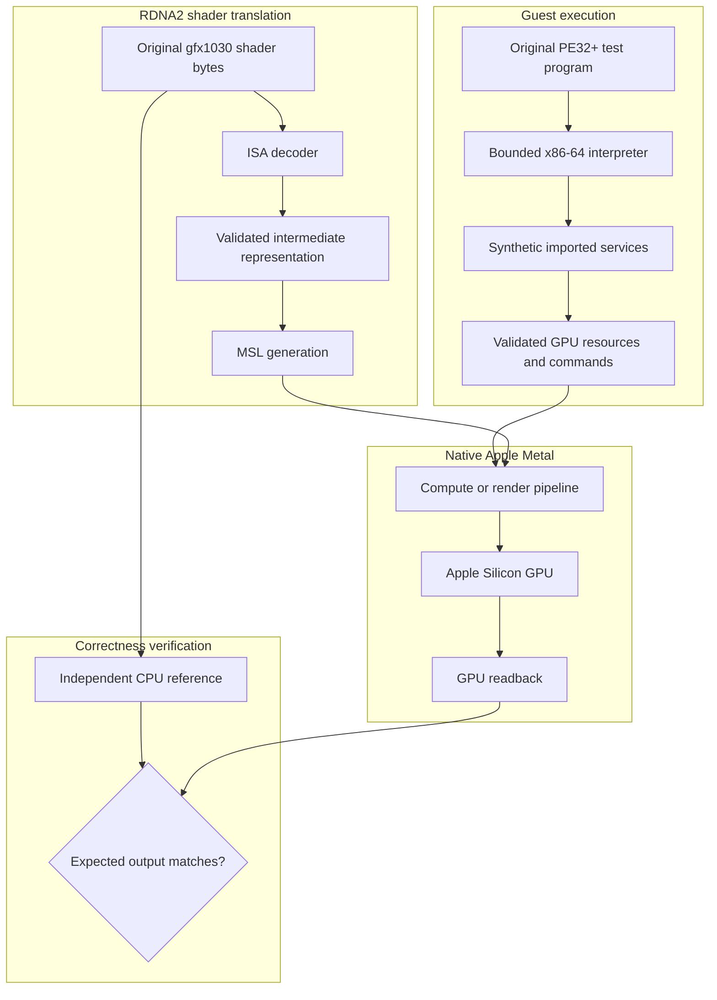

# Xenora

**Experimental Xbox Series X|S emulation research for Apple Silicon Macs.**

Xenora is an open-source project written primarily in Rust that builds and verifies a native, bounded execution environment on Apple Silicon: an independent x86-64 guest path, original PE32+ loading, AMD RDNA 2 shader translation, and a native Apple Metal graphics backend.

**No Wine. No CrossOver. No Rosetta. No Vulkan runtime.**

Xenora is still experimental. Verified work is restricted to independently authored synthetic programs and shaders; authentic Xbox executable loading, system-service compatibility and commercial game execution remain unsupported. See the [current limitations](#current-limitations).

### At a glance

- **Native graphics:** translated gfx1030 vertex and pixel stages and native passes (indexed draws, blend, depth) run on Apple Silicon GPUs — verified, see [Blend pass](#blend-pass) and [Verified Apple M5 results](#verified-apple-m5-results).
- **Guest execution:** bounded x86-64 execution, original PE32+ loading, synthetic services and guest-driven GPU dispatch — verified milestones X1–X9.
- **Not supported:** authentic Xbox executable loading and commercial game execution; see the [milestone table](#development-milestones).

[](https://github.com/ranveersoni98/Xenora/actions/workflows/ci.yml)

---

## What works today?

Xenora has progressed from executing individual x86-64 instructions to running original PE32+ guest programs that interact with translated GPU workloads on Apple Silicon.

The latest verified milestones include **translated gfx1030 vertex and pixel shaders executing through native Apple Metal**, the native Metal **blend pass** (`NativeCompute::render_blend`) and **indexed triangle draws** (`NativeCompute::render_indexed`) into offscreen targets, with rendered pixels compared against independently calculated reference results.

### Development milestones

| Milestone | Implementation | Status |
| --- | --- | --- |
| X1 — Guest CPU | Bounded x86-64 instruction execution on ARM64 macOS | Verified |
| X2 — Executable loading | Loading original fixed-base PE32+ test executables | Verified |
| X3 — GPU compute | Guest-submitted Metal compute workloads and readback | Verified |
| X4 — Metal rendering | Guest-driven offscreen rendering using authored Metal shaders | Verified |
| X5 — Guest execution expansion | Additional bounded CPU execution and fixture coverage | Implemented |
| X6 — Guest control flow | Nested calls, returns, checked memory and synthetic PE execution | Verified |
| X7 — Imported services | Named imports, guest-to-host service dispatch and result validation | Verified |
| X8 — Translated compute | Original gfx1030 compute shaders executing on Metal, partial Wave32 handling and BC1 readback | Verified subset |
| X9 — Translated graphics | Persistent resource handles, translated vertex/pixel stages and offscreen Metal rendering | Verified subset |
| X10 — Texture sampling | Translated image instructions are still planned; upload, readback and decode of BC compressed formats is implemented (see [Texture support](#texture-support)) | Planned |
| X11 — Graphics pipeline | Bounded multi-draw passes into offscreen RGBA8 targets: translated vertex and pixel stages, indexed triangle draws, colour write masks and blend state | Implemented |
| X12 — Wave execution | Expand Wave32/Wave64 semantics, divergent control flow, cross-lane operations, LDS and barriers | Planned |
| X13 — Advanced shaders | Mesh, geometry and additional compute shader capabilities with verified Metal execution. A first native Metal mesh-pipeline pass for indexed triangle lists is written but has not run on Apple hardware (see [mesh-stage notes](docs/research/mesh-stages.md)) | Started, unverified |
| X14 — CPU recompilation | Native ARM64 dynamic recompilation of supported x86-64 instructions in synthetic fixtures | Implemented subset |
| X15 — Executable compatibility | Static PE inspection reports sections, relocations, thread-local storage (TLS) callbacks, imports and entry-point instructions | Static probe implemented |
| X16 — Guest memory and threading | Virtual memory mapping, thread scheduling, synchronization primitives and atomic operations | Implemented subset |
| X17 — System services | Implement a tested subset of Xbox-compatible runtime APIs, memory services, filesystem access and application lifecycle | Implemented subset |
| X18 — Graphics API translation | Translate supported Xbox graphics commands, resource descriptors, command queues, barriers and fences into Metal operations | Planned |
| X19 — Advanced GPU features | Indirect rendering, asynchronous compute, additional texture formats and ray-tracing compatibility research | Planned |
| X20 — Integrated guest runtime | Connect CPU recompilation, executable loading, system services and graphics translation into one persistent runtime | Planned |
| X21 — Application compatibility | Execute increasingly complex independently authored applications through the complete guest CPU and GPU pipeline | Planned |
| X22 — First application boot | Establish a reproducible startup and error-reporting path for supported game-like applications | Planned |
| X23 — Initial game compatibility | Investigate startup and execution of legally supported game software, identifying missing runtime and graphics behavior | Long-term goal |
| X24 — Gameplay and performance | Expand rendering correctness, input, audio, memory management, shader caching and execution performance | Long-term goal |
| X25 — Running games | Achieve reproducible, stable execution of compatible games on native Apple Silicon macOS using Metal | Long-term goal |

**Roadmap note:** X10–X25 are proposed engineering milestones, not completed implementations or a guaranteed sequence. Actual priorities will change as compatibility testing reveals new blockers. Successfully completing one milestone does not guarantee that a particular game will run.

All existing verification refers to independently authored synthetic programs and shaders. Commercial-game compatibility remains unverified.

See the [X9 acceptance matrix](docs/testing/x9-acceptance.md) for specific tests, results and unsupported behavior.

## Native graphics translation

Xenora's graphics pipeline translates a supported subset of AMD RDNA 2 instructions into Metal Shading Language.

The translation process is:



The initial implementation focused on compute shaders. X9 extends this to actual translated **vertex and fragment/pixel shader stages**.

### Translated rendering

The current graphics subset supports:

- Original gfx1030 vertex and pixel shader fixtures.
- Decoding and translation into Metal shader functions.
- Vertex position transformation.
- Constant-color output and clipping.
- Interpolated vertex attributes.
- Offscreen RGBA8 render targets.
- Native GPU readback and pixel-by-pixel validation.
- Explicit rejection of unsupported shader forms.
- Flat-coloured triangle draws with colour write masks and blending (see [Blend pass](#blend-pass)).
- Indexed triangle draws (see [Indexed draws](#indexed-draws)).
- Depth testing with an optional `Depth32Float` attachment (see [Depth pass](#depth-pass)).

These are genuine translated shader stages, not merely demonstrations using handwritten Metal vertex and fragment programs.

The current rendering tests are deliberately narrow: original fixtures, a single triangle per draw, and controlled shader inputs and outputs.

### Blend pass

`NativeCompute::render_blend` draws up to 16 flat-coloured triangles in order into an offscreen RGBA8 target. Each draw has its own colour write mask (any subset of R, G, B, A) and either blending disabled or separate RGB and alpha blend factors (Zero, One, source and destination colour and alpha, and their one-minus forms) and operations (Add, Subtract, ReverseSubtract, and Min and Max). Colours are compared per channel against images derived independently (in exact fractions) from the public Metal blend equations.

GPU verification (Metal API and shader validation enabled): 39 Metal-validated passes over two original overlapping triangles — a clear-only pass; blending disabled; each source factor with the destination term zeroed and each destination factor with the source term zeroed; every operation; additive clamping; separate alpha factors; a separate alpha operation; eight write masks; and a pass whose first draw is itself blended and masked. On an Apple M5 Pro every rounded channel matched round-to-nearest exactly.

### Indexed draws

`NativeCompute::render_indexed` issues one real `drawIndexedPrimitives` call per draw (up to 16) on a 16- or 32-bit index buffer with a start index and a signed base vertex, into an offscreen RGBA8 target. A draw can sample an original BC1 texture uploaded natively.

GPU verification (Metal API and shader validation enabled): 16 Metal-validated passes (both index sizes, 32-bit indices above 16 bits, odd 16-bit start, positive and negative base vertex, reversed winding, flat and textured two-triangle draws, draw order, BC1-textured draws), compared per pixel against images derived independently from the geometry, the public D3D12 and Metal index semantics and the public BC1 rules.

### Depth pass

`NativeCompute::render_depth` draws up to 16 triangles in order into an offscreen RGBA8 target with an optional `Depth32Float` attachment, a chosen clear depth, a per-draw depth compare function (all eight) and depth write enable. Colour and the stored depth are both read back.

GPU verification (Metal API and shader validation enabled): 30 Metal-validated passes of original overlapping triangles: clear, every compare function at three depths, write enabled and disabled, depth test disabled with an attachment and no attachment at all, and a BC1-textured draw.

### Verified Apple M5 results

The X9 native Metal acceptance run reported **20 passing tests, zero failures and zero ignored tests**, with Metal API and GPU validation enabled. The newer passes below are separate Metal-validated campaigns, also with Metal API and shader validation enabled.

Representative checks include:

| Test | Verified behavior |
| --- | --- |
| Constant-color rendering | 12 red pixels and 12 clear pixels |
| Vertex transformation | 3 rendered pixels versus 7 for a pass-through control |
| Perspective interpolation | Exact checks of 16 pixels and another 16 after swapping vertex color channels |
| BC1 texture handling | 33 texels across selected mip levels and array layers |
| Guest rendering | PE32+ guest receives and checks the translated render output |
| Blend pass | 39 Metal-validated passes over two overlapping triangles |
| Indexed draws | 16 Metal-validated passes (both index sizes, signed base vertices, draw order) |
| Depth pass | 30 Metal-validated passes (all eight compare functions, no-attachment case) |

The expected results were calculated independently of the production shader translation path.

**Important:** Correct output for these fixtures does not prove general RDNA2 compatibility or correctness for arbitrary Xbox shaders.

## Persistent GPU resources

X9 introduces a bounded GPU resource-management system for synthetic guest programs.

The implementation includes:

- Generation-checked guest resource handles.
- Buffer creation, updates, reuse and destruction.
- Checked buffer views and memory permissions.
- Repeated compute submissions.
- Resource lifetime validation.
- Snapshot behavior for queued submissions.
- Rejection of stale handles and malformed resource requests.
- Guest-visible readback and result verification.

The original X9 PE fixtures exercise these services through the guest execution environment.

The resource system remains experimental. Native GPU work already in flight during resource release, persistent Metal texture residency across guest calls, and general asynchronous execution are not yet implemented.

## Texture support

Xenora includes original texture upload, readback and block-compression paths.

Implemented and tested functionality includes:

- Validated mip levels and array layers.
- Pitched texture uploads.
- Block-compressed texture handling, including BC4/BC5 upload and readback and a CPU BC7 decoder for the eight modes.
- Native Metal texture readback.
- Edge-block and transparency tests.
- Invalid descriptor and bounds rejection.

**Translated texture-sampling instructions are not yet implemented.**

The existing texture readback path uses authored Metal kernels. It should not be confused with executing arbitrary RDNA2 texture-fetch instructions.

Xbox-specific texture layouts and additional compression formats require further research and validation.

## Architecture

Xenora is organized around three connected subsystems: guest execution, shader translation and native GPU execution.



Xenora's host execution environment is native ARM64. The guest architecture being interpreted is x86-64.

The native graphics pipeline runs translated vertex and pixel stages, the indexed-draw and blend passes and the depth pass into offscreen Metal targets, with GPU readback compared against independent CPU references.

The project does not currently provide a general-purpose x86-64 dynamic recompiler or a complete Xbox operating-system implementation.

See [Interface Contracts](docs/interfaces.md) for the documented execution and resource boundaries.

---

## Current limitations

Xenora is an engineering research project, not a working commercial-game emulator.

The following remain unsupported or incomplete:

| Subsystem | Outstanding work |
| --- | --- |
| Guest CPU | Broad x86-64 instruction coverage, multithreading and performant dynamic recompilation |
| Executable loader | General relocations, TLS, DLL initialization and authentic Xbox startup |
| Xbox runtime | Console-specific services, system APIs, filesystem and application lifecycle |
| RDNA2 shaders | General control flow, broader instructions, Wave64, cross-lane operations and mesh stages |
| Graphics | Translated texture sampling and broader resource binding |
| Textures | Authentic Xbox memory layouts and translated sampling |
| Performance | Production-scale workloads, CPU/GPU profiling and optimized execution |
| Game compatibility | No demonstrated execution of commercial Xbox titles |

Xenora's current shader fixtures target a bounded subset of desktop gfx1030 behavior. This is not equivalent to complete Xbox Series GPU compatibility.

Progress is measured by reproducible tests rather than estimated game compatibility percentages.

---

## Building Xenora

### Requirements

- Apple Silicon Mac running native ARM64 macOS.
- Rust toolchain with `aarch64-apple-darwin` support.
- Xcode and Metal development tools.
- Python 3.11 or newer.
- LLVM with AMDGPU support for applicable shader-fixture assembly and verification.

The recorded Apple M5 environment uses Rust 1.100.0 and Xcode 27.2.

### Clone

```sh
git clone https://github.com/ranveersoni98/Xenora.git
cd Xenora
```

### Build

```sh
scripts/bootstrap.sh
cargo build --locked -p xenora
```

### Run core tests

```sh
cargo fmt --all -- --check
cargo clippy --locked --workspace --all-targets -- -D warnings
cargo test --locked --workspace
```

The format, lint and test trio is the standard check set. The native Metal
passes use Metal API and shader validation; `scripts/audit/status.py --check`
verifies the generated status tables.

### Run native Metal tests

These require a Metal-capable Apple Silicon Mac.

```sh
scripts/test-gpu.sh
```

The native test suite enables Metal API and shader validation and tests the supported compute, rendering and texture paths.

### Verify guest execution

```sh
cargo test --locked \
  --manifest-path experiments/x1/Cargo.toml \
  --target aarch64-apple-darwin \
  --features metal
```

Run the original guest resource integration tests:

```sh
tests/compat_fixtures/verify-resources.sh
```

Additional checks:

```sh
tests/compat_fixtures/verify.sh
tests/compat_fixtures/verify-compute.sh
scripts/assemble-fixture.sh --check
scripts/demo.sh
```

Some verification paths require additional tools. Refer to the relevant test scripts and documentation before interpreting a missing dependency as a test failure.

### Test evidence

Testing distinguishes between:

- **CPU correctness:** Independent expected values and bounded execution.
- **Shader compilation:** Decoding, lowering and valid generated Metal source.
- **Native GPU execution:** Actual GPU work and checked readback.
- **Guest integration:** Original test executables invoking GPU services and checking results.
- **Unsupported behavior:** Explicit rejections and documented missing functionality.

Compiling a shader is not equivalent to proving its GPU output is correct.

### Where the work is heading

See the [roadmap table](#development-milestones) for proposed milestones, and the [changelog](CHANGELOG.md) for the current unreleased additions, such as the native blend pass, indexed draws and the depth pass. The remaining research steps are the outstanding items in [current limitations](#current-limitations).

---

**The goal is to build a trustworthy native Apple Silicon compatibility framework, one verifiable subsystem at a time.**

---

### Contributors

[](https://github.com/ranveersoni98/Xenora/graphs/contributors)

## License

Xenora is licensed under the [GNU General Public License v3 or later](LICENSE).

See [THIRD_PARTY_NOTICES.md](THIRD_PARTY_NOTICES.md) for third-party attribution and [docs/legal.md](docs/legal.md) for the project's research and legal boundaries.

Xenora is an independent open-source project and is not affiliated with Microsoft, Xbox, Rockstar Games or Apple.

---